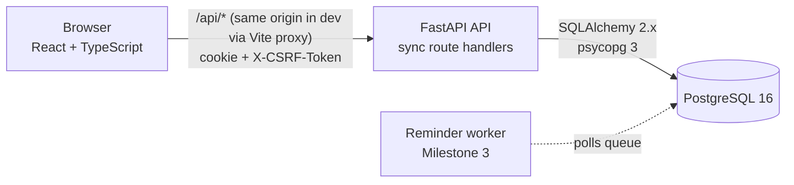
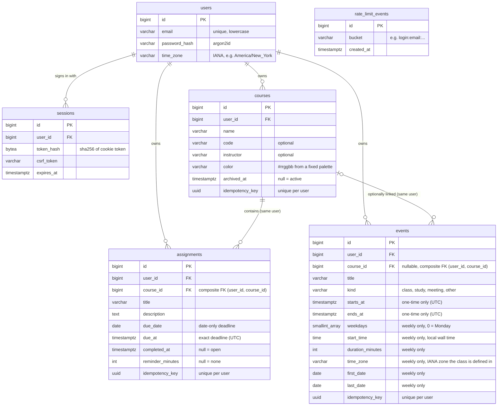

# CampusFlow

A college planner for keeping every course, class, and deadline in one place: what's overdue, what's due today, where you need to be this week, and which plans clash, all in your own time zone.

Built as a full-stack portfolio project: a React + TypeScript frontend, a FastAPI backend, PostgreSQL, and (in a later milestone) a separate worker for durable reminders.


## Status

| Milestone | Scope | State |
| --- | --- | --- |
| 1 | Accounts, courses, assignments, persistent storage | **Done** |
| 2 | Weekly calendar, recurring classes, conflict detection | **Done** |
| 3 | Durable reminders and notification settings | Not started |
| 4 | Demo account, deployment, usability, portfolio docs | Not started |

## The problem

Students juggle deadlines from four to six courses, each with its own syllabus, LMS page, and habits. Deadlines get missed less from forgetting than from not seeing them in one place at the right time. CampusFlow's target workflows:

1. **Morning check:** open Today and see what's overdue, what's due today, and the week ahead.
2. **Capture fast:** a professor announces a deadline, so press <kbd>N</kbd>, type a title, and save. The last course you used is remembered.
3. **Find and filter:** search assignments, filter by course, status, overdue, or date range, and sort by deadline.
4. **Finish:** check an assignment off. It's saved before it's shown as done, and it can be undone.
5. **Plan the week:** see classes, meetings, and deadlines on one week grid, and get warned before booking two things at once.
6. **End the semester:** archive a course to keep its history without cluttering the lists.

## Screenshots

| | |
| --- | --- |
|  |  |
|  |  |
|  |  |
|  |  |
|  |  |
|  | |

 

## Architecture



One frontend, one API, one database, plus one worker in Milestone 3. Nothing else is needed yet.

**How a request flows:** the browser calls `/api/...` with the session cookie. FastAPI loads the session (dependency `require_auth`), checks the CSRF header on writes, and runs the handler in its threadpool. The handler reads or writes with SQLAlchemy, filtering every query by the signed-in user's ID, then commits. Pydantic validates the input on the way in and shapes the output on the way out. The frontend caches responses with TanStack Query and refetches the affected views after every write.

### Database



Exactly one of `due_date` or `due_at` is set; a check constraint enforces it. Likewise an event is either one-time (`starts_at`/`ends_at`) or weekly (the rule columns), never a mix. Weekly occurrences aren't stored: they're computed from the rule for whatever window is asked for (see [Calendar](#calendar-rules-are-stored-occurrences-are-computed)).

## Tech stack and versions

| Layer | Choice | Version |
| --- | --- | --- |
| Frontend | React, TypeScript, Vite | 19.3, 6.0, 8.3 |
| Data fetching | TanStack Query | 5.104 |
| Routing | React Router | 8.5 |
| UI details | lucide-react icons, Sonner toasts, Instrument Sans (self-hosted) | 1.61, 2.0, 5.x |
| Backend | Python, FastAPI, Uvicorn | 3.12+, 0.159, 0.54 |
| Database | PostgreSQL, SQLAlchemy, Alembic, psycopg | 16, 2.1, 1.20, 3.3 |
| Validation | Pydantic, pydantic-settings | 2.14, 2.16 |
| Passwords | argon2-cffi (Argon2id) | 25.1 |
| Tests | pytest, Playwright | 9.1, 1.64 |
| Tooling | uv, ruff, mypy (strict), oxlint, Prettier | 0.11, 0.17, 2.4, 1.x, 3.x |

Exact versions are pinned in `backend/uv.lock` and `frontend/package-lock.json`. Node is pinned to 24 in `frontend/.nvmrc`. Node 24 is the newest LTS line today; Node 26 becomes Active LTS on October 27, 2026, and moving to it is a one-line change.

## Running it locally

Prerequisites: PostgreSQL 16, [uv](https://docs.astral.sh/uv/), and Node 24.

```bash
# 1. Database role (once). CREATEDB lets the tests create throwaway databases.
createuser --createdb --pwprompt campusflow      # password: campusflow (dev only)

# 2. Backend
cd backend
cp .env.example .env                             # adjust if your database differs
uv sync                                          # installs exact locked versions
uv run python -m scripts.ensure_db               # creates the database if missing
uv run alembic upgrade head                      # applies migrations
uv run uvicorn app.main:app --reload --port 8000

# 3. Frontend (another terminal)
cd frontend
npm ci
npm run dev                                      # http://localhost:5173
```

The Vite dev server proxies `/api` to the API on port 8000, so the browser sees a single origin.

### Environment variables

All backend settings use the `CAMPUSFLOW_` prefix. See [`backend/.env.example`](backend/.env.example). The important ones:

| Variable | Default | Notes |
| --- | --- | --- |
| `CAMPUSFLOW_DATABASE_URL` | local `campusflow` DB | SQLAlchemy URL with the `postgresql+psycopg://` driver |
| `CAMPUSFLOW_ALLOWED_ORIGINS` | Vite dev origins | JSON list. Writes from any other origin are rejected |
| `CAMPUSFLOW_SESSION_COOKIE_SECURE` | `false` | **Must be `true` in production** (HTTPS-only cookie) |
| `CAMPUSFLOW_SESSION_COOKIE_NAME` | `cf_session` | Use `__Host-cf_session` in production |
| `CAMPUSFLOW_SESSION_IDLE_DAYS` / `_ABSOLUTE_DAYS` | 7 / 30 | Sliding and absolute session lifetimes |
| `CAMPUSFLOW_LOGIN_MAX_FAILURES_PER_EMAIL` | 5 per 15 min | Also a per-IP limit (30) |

No secrets are committed. `.env` files are git-ignored.

## Testing and checks

```bash
# Backend: each run creates its own PostgreSQL database and drops it afterwards
cd backend
uv run ruff format --check . && uv run ruff check . && uv run mypy app tests scripts
uv run pytest --cov=app

# Frontend
cd frontend
npm run format:check && npm run lint && npm run typecheck && npm run build
npm test                          # calendar layout unit tests (Node's built-in runner)

# Browser tests: start their own API (on a separate campusflow_e2e database) and dev server
npx playwright install chromium   # once
npm run test:e2e
```

GitHub Actions ([`.github/workflows/ci.yml`](.github/workflows/ci.yml)) runs all three jobs on every push and pull request, with a PostgreSQL 16 service container.

What the 83 backend tests cover (98% line coverage):

- **Auth:** HTTP-only cookie, email normalization, generic login errors, server-side logout (a replayed cookie fails), idle and absolute expiry, CSRF header required for writes, cross-origin writes rejected, login throttling that survives across clients, password change signing out other devices, account deletion.
- **Isolation:** another user's records return 404 by ID for read, edit, complete, delete, archive, and deletion-impact. An assignment can't be attached to another user's course, and the database itself rejects such a row. Idempotency keys are scoped per user.
- **Assignments:** validation, lifecycle, every filter, title search with literal `%` and `_`, both sort orders, the Today grouping, idempotent create (including six concurrent double-submits), and the likely-duplicate warning and its exact matching rule.
- **Courses:** validation, idempotent create, archive keeps data, and delete requires the confirmed count and cascades in one transaction.
- **Time:** spring-forward gaps, fall-back overlaps, overdue exactly after 11:59 PM local, time zone changes, and "today" computed in the user's zone rather than UTC.
- **Scheduling rules (pure functions, no database):** adjacent events don't conflict, a one-minute overlap does, overnight events clash with the next morning, weekly expansion stays inside both the window and the series dates, classes keep their local time through daylight saving, a class start in the spring-forward gap moves forward, a repeated fall-back time uses the first one, and a class defined in another zone keeps that zone's wall time.
- **Calendar API:** validation (end after start, unique weekdays, series at most a year), conflict warnings for one-time and recurring events with **Save anyway**, deadlines that never block time, overnight events, editing a whole series, idempotent create, bounded windows, archived courses' events hidden and ignored for conflicts, events on Today, deleting a course with its events, and isolation between users.

Seven frontend unit tests cover the week grid's geometry: overnight events split across two days, overlapping events side by side, adjacent ones not, and the visible hour range.

The Playwright test walks one student through the app: register, add a course, add an overdue assignment, trigger the duplicate warning and the discard prompt, add a weekly class and a clashing meeting on the calendar, save past the conflict warning and see both flagged in the agenda, search, complete, reload, sign out, and sign back in. A second test checks the wrong-password error.

## Key decisions

### Synchronous SQLAlchemy with `def` route handlers

Every handler is a plain `def`, not `async def`. FastAPI runs `def` handlers in a threadpool, so a blocking database call ties up one worker thread while the event loop keeps serving other requests. Mixing `async def` with a blocking driver would freeze the loop for every request during each query. Sync SQLAlchemy is also simpler to read, debug, and test. The tradeoff is that concurrency is bounded by the threadpool size (40 by default), which is far beyond what this app needs. A busier deployment would add API instances before needing async.

### Sessions instead of JWTs

Login creates a row in `sessions`, and the cookie holds a random 256-bit token. Only its SHA-256 is stored, so a leaked database can't be replayed as cookies. Logging out deletes the row, which ends the session immediately; a JWT can't be revoked that simply. The cookie is `HttpOnly` (unreadable by JavaScript), `SameSite=Lax`, and `Secure` in production. Sessions slide for 7 days of inactivity and end after 30 days regardless. Changing your password deletes every other session.

### CSRF and origins

Two layers:

1. Each session has its own CSRF token. The frontend gets it from `/api/auth/session` and sends it as `X-CSRF-Token` on every write. A malicious site can make the browser send the cookie, but it can't read the token.
2. Middleware rejects any `POST`, `PUT`, `PATCH`, or `DELETE` whose `Origin` header isn't allow-listed. This covers login and registration, which happen before a session exists.

CORS is configured explicitly for the same allow-list. It only matters if the frontend and API end up on different origins in production (decided in Milestone 4).

### Login rate limiting in PostgreSQL

Failed logins are rows in `rate_limit_events`, keyed by email and by IP: 5 failures per email or 30 per IP in 15 minutes. Because the counter is in the database, the limit holds across multiple API instances and restarts. A transaction-scoped advisory lock per key stops parallel requests from all slipping under the limit at once. A successful login clears that email's failures, and old rows are pruned.

### Ownership is enforced twice

Every query filters by the user ID taken from the session, never from the request. Another user's record looks exactly like a missing one (404), so IDs can't be probed. As a backstop, assignments reference courses through a composite foreign key on `(user_id, course_id)` → `courses(user_id, id)`. Even a bug in the API couldn't link an assignment to someone else's course; PostgreSQL would refuse the row.

### Duplicates: two different problems

- **Double-clicks and retries** create true duplicates. The form generates a UUID when it opens and sends it as `Idempotency-Key`. It's stored on the row under a unique `(user_id, idempotency_key)` constraint, and the insert uses `ON CONFLICT DO NOTHING`. A repeat returns the original record (`200`, `Idempotent-Replayed: true`) even when both requests arrive at the same moment. The test fires six concurrent identical requests and expects exactly one row.
- **Likely duplicates** are the user's call. If the same course already has an assignment with the same title (trimmed, case-insensitive) on the same due date, the API answers `409 likely_duplicate` with the matches. The form shows them, and **Save anyway** resends with `allow_duplicate: true`.

### Archive vs. delete

Archiving sets `archived_at`. Every assignment stays, but the course is hidden from Today, lists, and pickers, and can't get new work until it's restored. Deleting first shows how many assignments and calendar events will go with it. The `DELETE` request must include those confirmed numbers (`?expected_assignments=7&expected_events=2`). The API locks the course row, recounts, and refuses with `409` if the number changed, so you never delete more than you agreed to. The cascade happens in the same transaction.

### Time zones

Each account has an IANA time zone, set from the browser at sign-up and changeable in Settings.

| Kind of deadline | Stored as | Example |
| --- | --- | --- |
| Date-only ("due Friday") | `due_date DATE` | `2026-10-23` |
| Exact time ("due Friday 5 PM") | `due_at TIMESTAMPTZ` in UTC | `2026-10-23 21:00:00+00` |

Rules, all computed on the server so every view agrees:

- **A date-only deadline never moves.** Due Oct 23 stays Oct 23 whatever your zone. It becomes overdue once Oct 23 has fully passed in your current zone, at local midnight after 11:59 PM. Example: due Oct 14 in New York is still on time at 11:59:59 PM EDT and overdue at 12:00 AM. If you switch to Los Angeles, it's overdue at midnight Pacific instead.
- **An exact deadline keeps its moment.** 9:00 AM in New York is 13:00 UTC. Switch to Los Angeles and it shows as 6:00 AM, the same instant. Switch to London and a 11:30 PM New York deadline shows as 4:30 AM the next day.
- **Times that don't exist are rejected.** On March 8, 2026, New York clocks jump from 2:00 to 3:00 AM, so "due 2:30 AM" gets a clear error.
- **Times that happen twice are flagged.** On November 1, 2026, 1:30 AM happens twice. CampusFlow uses the first one (EDT) and tells you so after saving.
- **Today and "next 7 days"** use your zone's calendar date, not UTC. At 10 PM in New York it's still today, even though it's already tomorrow in UTC.

Settings shows a live preview of what a time zone change will do before you save.

### Calendar: rules are stored, occurrences are computed

A weekly class is stored once, as a rule: days of the week, local start time, duration, its IANA zone, and first and last class dates. The API turns rules into concrete occurrences only for the window being viewed (at most 42 days), in [`backend/app/scheduling.py`](backend/app/scheduling.py), a module of pure functions with no database or web code. One-time events are stored as exact UTC instants.

The tradeoff: storing every occurrence as its own row would make queries trivial and allow cancelling one meeting, but editing a class would mean rewriting a semester of rows and keeping them in sync. Computing on read keeps one source of truth and makes "edit the series" a single update. The cost is CPU on every read (small: a week of a full schedule is a few dozen occurrences) and no per-occurrence exceptions yet. The edit dialog says so: "Changes apply to every meeting in this series."

Scheduling rules:

- **An event occupies [start, end).** A class ending at 10:00 and one starting at 10:00 don't conflict. Deadlines are markers and never occupy time.
- **Conflicts are a warning, not a block.** Saving an overlapping event returns `409 schedule_conflict` listing what it overlaps (including every future meeting of a weekly class). The form shows them, and **Save anyway** resends with `allow_conflicts: true`. Overlaps stay flagged on the grid, in the agenda, and on Today.
- **Overnight events work.** A 10 PM to 12:45 AM event ends the next day. The week grid draws it on both days, and it conflicts with anything early the next morning.
- **End must be after start.** For a one-time event that's checked on the exact instants. For a weekly class, an end time earlier than the start means "ends the next day".
- **Archived courses' events are hidden** and ignored for conflicts, and come back when the course is restored.

Time zones for events:

- **A class keeps its local time.** A Friday 9:00 class in New York is 13:00 UTC in October and 14:00 UTC after clocks fall back on November 1, 2026, and it shows as 9:00 both weeks.
- **A class keeps its own zone.** It's defined in the zone you were in when you created it. If you move to Los Angeles, that 9:00 New York class shows at 6:00 AM, which is when it actually happens. A one-time event keeps its instant, like an exact deadline.
- **Skipped times move forward for classes.** If a weekly class starts at 2:30 AM, the meeting on March 8, 2026 (when New York skips from 2:00 to 3:00) happens at 3:30 AM. For a single event, a time that doesn't exist is rejected with an explanation instead, since there's no series to keep consistent.
- **Repeated times use the first one.** On November 1, 2026, 1:30 AM happens twice; CampusFlow uses the first (EDT) and says so after saving a one-time event.

## Design

The interface follows three design skills: Impeccable's rules for product UI, Emil Kowalski's design-engineering and motion guidance, and the Taste skill's app-screen study. Concretely:

- **Layout:** one typeface (Instrument Sans, chosen because it has true tabular figures for dates and counts) and flat surfaces split by 1px lines.
- **Color:** reserved for course identity, overdue status, and the single near-black primary action. Light and dark themes follow the OS.
- **Motion:** feedback only: buttons press to 0.97 scale, dialogs enter in 180ms with a strong ease-out, and everything respects reduced-motion settings.
- **States:** every block has real loading skeletons, empty states that say what to do next, and in-place errors with Retry.
- **Accessibility:** visible focus rings, labeled fields, a skip link, keyboard-reachable everything, and 4.5:1 text contrast in both themes.
- **Forms never lose input:** a failed save keeps every field, and closing a form with edits asks first.

The week grid follows the same rules: course colors appear only as event tints and deadline dots, conflicts get a red edge and a warning icon (never color alone), and phones get the agenda, a list that works with screen readers, instead of a cramped grid.

The Taste inspector reports 0 failures on every screen. The main remaining warning is deliberate: calendar axis labels and event details use 12px text, because a week of classes has to fit on one screen. Editable designs (components, color variables, and the main screens in light and dark, including the week grid, the calendar event component, and the conflict dialog) live in a Figma file in the project owner's drafts.

## Known limitations (as of Milestone 2)

- Editing a weekly class changes every meeting, past and future. Skipping or moving a single meeting (a holiday, a moved lab) isn't supported yet.
- Only weekly repetition. A series can run at most one year, and a one-time event at most 14 days.
- Events of archived courses are hidden from the calendar until the course is restored.
- Phones show the week as an agenda list only; the grid needs a wider screen.
- Reminder preferences are saved but not delivered yet (Milestone 3). The form says so.
- The "last course used" memory is per device (browser storage), not per account.
- Registering with an email that already exists says so. This lets someone check whether an address has an account, a tradeoff accepted for clearer sign-up errors. Registration is rate limited per IP.
- The assignment list returns at most 500 rows with no pagination. Performance with large datasets is measured in Milestone 4.
- If the session expires while a form is open, saving shows a "sign in again" message and keeps the form, but signing in happens in a separate step.

## Project layout

```
backend/
  app/            FastAPI app: config, db, models, schemas, security, routers/
                  scheduling.py (pure recurrence and overlap rules), calendar.py (loading and shaping)
  alembic/        migrations
  scripts/        ensure_db.py
  tests/          pytest suite (disposable PostgreSQL per run)
frontend/
  src/            React app: api.ts, pages/, components/, styles.css
                  calendarLayout.ts (+ .test.ts): week grid geometry
  e2e/            Playwright tests
docs/screenshots/
.github/workflows/ci.yml
```
